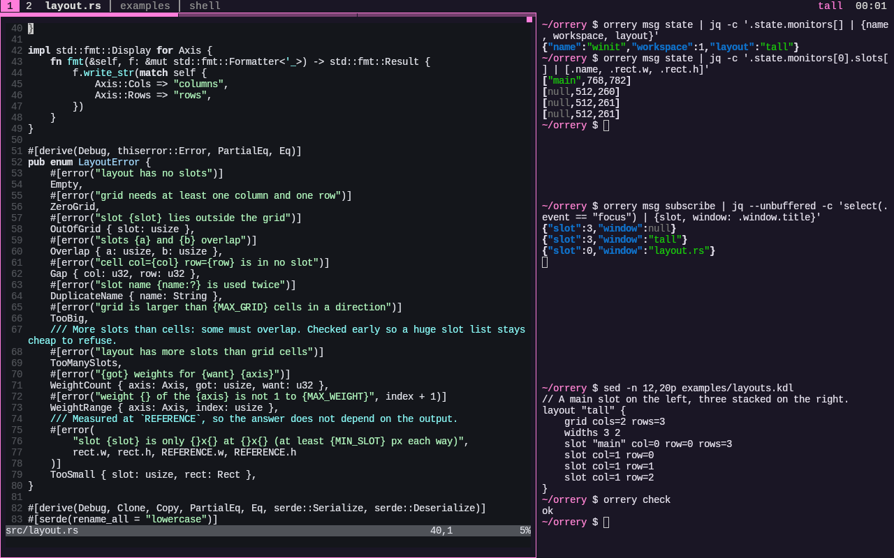
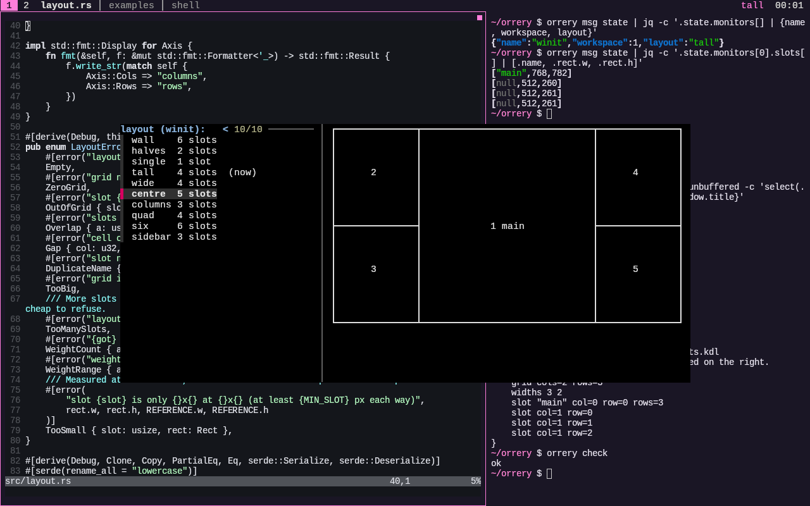

<h1 align="center">orrery</h1>

<p align="center">
  <b>A static tiling Wayland compositor that spans machines.</b><br>
  Windows stay where you put them, windows that belong together stack in one place,<br>
  and one keyboard and mouse drive every screen of every machine on your desk.
</p>

<p align="center">
  <a href="#what-orrery-is">What it is</a> ·
  <a href="#quick-start">Quick start</a> ·
  <a href="docs/manual.md">Manual</a> ·
  <a href="examples/config.kdl">Example config</a> ·
  <a href="docs/plans/">Design notes</a>
</p>

<p align="center">
  
  
  
</p>

<p align="center">
  
</p>
<p align="center">
  <sub>One screen in the <code>tall</code> layout, under the kitty desktop's bar. The main slot holds three tabs;
  holding <code>Mod+Space</code> shows its tab strip.</sub>
</p>

---

## What orrery is

orrery is a Wayland compositor and tiling window manager, written in Rust on
[Smithay](https://github.com/Smithay/smithay). All of it in one paragraph:

> Each screen is divided into fixed **slots** that never rearrange themselves. A slot holds **tabs**, and every tab
> is a **stack**: windows that belong together, piled up, so a dialog or a program started from a terminal opens on
> top of what it came from and gives the place back when it closes. And orrery is **distributed**: run it on every
> machine on your desk and they join into one desktop, with one set of workspaces across all their screens and one
> keyboard and mouse that go wherever you are working.

Those are three ideas. One at a time:

### 1. Nothing moves unless you move it

Most tiling window managers are *dynamic*: open or close a window and the others shuffle and resize to make room.
orrery is *static*. You write each **layout** once, as a grid of **slots**, and a slot stays where it is whatever
opens or closes. A window is the size of its slot, or of its whole screen when you ask for fullscreen. Nothing
floats, and nothing is resized by its neighbours.

In the picture above the screen is in the `tall` layout: a main slot on the left and three slots on the right.
A layout is a few lines of config, a [library of eight](examples/layouts.kdl) comes ready to include, and a key
switches between them.

There are ten **workspaces**. Each screen shows one, and each workspace has a layout of its own. Workspace 1 is
locked to screen 1, workspace 2 to screen 2, and the others stay on the screen where you first opened them, so a
workspace key always takes you to the same place.

### 2. A slot holds tabs, and every tab is a stack

What changes is what a slot holds, and it holds things two levels deep.

**Tabs** are for things that share a place: an editor, its documentation and a shell, say. A slot shows one tab at
a time and you cycle through them, as in a browser. Whatever you launch with a key or the launcher opens as a new
tab in the slot that had the focus when you launched it, even if you have moved on by the time its window appears.

A **stack** is for windows that belong together, and every tab is one: a pile of windows of which you see only the
top. A dialog opens on top of its parent. A program you start from a terminal opens on top of that terminal. Close
the top window and the one beneath is there again, exactly where it was.

```
a slot
 ├─ tab 1   an editor, and on top of it its "Save as" dialog      you see the dialog
 ├─ tab 2   a terminal, and on top of it the viewer you ran       you see the viewer
 └─ tab 3   a browser                                             you see the browser
```

A stack moves as one thing: send a tab to another slot or another workspace and everything in it goes along, the
program together with the terminal that started it. `split` lifts the top window out into a tab of its own. If
you would rather have tabs only, one setting makes every new window a tab (dialogs still stack on their parent).
Holding `Mod+Space` shows every slot's tabs as a strip along its top, as in the picture.

### 3. One desktop across several machines

Run orrery on each machine on your desk, give them one shared secret, and they join into one **session**: a
*primary*, which is the machine whose keyboard and mouse you use, and any number of *satellites*.

```
        "desk", the primary                               "side", a satellite
 +-------------+  +-------------+                        +-------------+
 | workspace 1 |  | workspace 2 |  <---- encrypted ----> | workspace 3 |
 +-------------+  +-------------+          link          +-------------+
   your keyboard and mouse  ---- Mod+3, or the pointer pushed past the edge ---->
```

- **One set of workspaces.** The workspace numbers run across every screen of every machine: the primary's screens
  first, then each satellite's. `Mod+3` shows workspace 3 on whichever machine has it.
- **One keyboard and mouse.** They follow the focus. Press the key of a workspace on another machine, or push the
  pointer past the edge of the last screen, and from then on your typing, clicks and scrolling happen on that
  machine, key binds included, in your own keyboard layout. `Mod+Escape` always brings them home, and each
  machine's own keyboard and mouse keep working all along.
- **Windows stay on their machine.** Every machine runs and draws its own programs. Only input and commands travel
  (`orrery msg --to side spawn kitty` starts a terminal on the other machine); no pixels cross the network, so
  nothing is streamed. It is the sharing a software KVM gives you, built into the compositor.
- **Nothing to set up but the secret.** The link is encrypted and authenticated with it (Noise over TCP). orrery is
  the compositor at both ends, so it needs no portal, no virtual input device and no extra permission. A machine
  that drops off keeps working by itself and rejoins when it can.

On one machine none of this is in the way: orrery is then simply a static tiling compositor.

### And the rest

- **A config that cannot lock you out.** The config is one [KDL](https://kdl.dev) file, watched and reloaded within
  a second. A broken file changes nothing: the old config keeps running, a red bar along the top says so, and
  `orrery check` names every problem as `FILE:LINE:COL`.
- **Scriptable.** `orrery msg` runs the actions the keys run, over a control socket: focus, move, split, layouts,
  workspaces, spawn. `orrery msg state` is the whole desktop as JSON; `orrery msg subscribe` is an event stream,
  one JSON line per change, made for bars.
- **Three ways to run:** on **bare metal** (DRM/KMS, libinput, a seat from logind, elogind or seatd), **nested**
  as a window inside another Wayland compositor, and **headless** for tests.
- **Several monitors**, each a screen with its own workspace and layout, coming and going as they are plugged in.
- **A desktop made of kitty.** [`examples/kitty/`](examples/kitty) adds a bar on every screen, a drop-down
  terminal, an application launcher and a layout picker that draws each layout, all as small scripts driven by
  `orrery msg`. One `include` line brings it in.
- **The protocols a desktop needs:** xdg-shell with popups and menu grabs, fullscreen, layer-shell (bars,
  launchers, wallpapers), xdg-activation (a window asking for attention is marked, never raised),
  xdg-decoration, linux-dmabuf (OpenGL and Vulkan clients render on the GPU), and copy and paste between clients.
- **Tested without a screen:** about 500 tests, most of them end to end: a headless orrery driven through real
  Wayland client connections and its control socket.

## Quick start

### Build

You need a current stable Rust toolchain and the development files for `libseat`, `libinput`, `libudev`,
`libgbm`, `libdrm` and `libxkbcommon`; at run time, Mesa (or another EGL and GLES implementation) and, to run
nested, the Wayland client libraries.

```sh
git clone https://github.com/cobalt-reel/orrery
cd orrery
cargo build --release
```

The binary is `target/release/orrery`; put it on your `PATH`, or `cargo install --path .`.

### Try it nested

From a terminal inside the Wayland desktop you already use:

```sh
orrery run
```

orrery opens as a window. `Super+Return` starts a terminal in it (kitty, unless your config says otherwise),
`Super+H/J/K/L` moves the focus between slots, and `Super+Shift+E` quits. If your desktop keeps the Super key for
itself, hand the keys over (the [manual](docs/manual.md#default-keys) shows how in Hyprland) or pick another
modifier with `mod "Alt"` in the config.

### Run it on bare metal

Log in on a text console and run the same command:

```sh
orrery run 2>~/orrery.log
```

It needs a seat (logind, elogind or seatd) and a GPU with KMS; it needs no privileges of its own. Every connected
monitor becomes a screen. See [Bare metal](docs/manual.md#bare-metal) for the details and the limits.

### Configure

orrery reads `~/.config/orrery/config.kdl`. Without one it uses the built-in config, which is
[`examples/config.kdl`](examples/config.kdl) word for word: copy that file and change it.

```kdl
layout "tall" {
    grid cols=2 rows=3
    widths 3 2
    slot "main" col=0 row=0 rows=3
    slot col=1 row=0
    slot col=1 row=1
    slot col=1 row=2
}

monitor "DP-1" layout="tall"      // each monitor starts on a layout of its own

binds {
    "Mod+Return" spawn "kitty"
    "Mod+L" focus-slot "right"
    "Mod+Shift+L" move "right"   // the current tab, its whole stack, to the slot on the right
    "Mod+Tab" cycle-tab "next"
    "Mod+F" toggle-fullscreen
}
```

```sh
orrery check        # ok, or every problem as FILE:LINE:COL
```

## The keys you will use most

`Mod` is Super unless the config says otherwise. The [full table](docs/manual.md#default-keys) is in the manual.

| Keys | |
|------|---|
| `Mod+Return` | start a terminal, as a new tab in the focused slot |
| `Mod+H` `J` `K` `L` | focus the slot left, down, up, right |
| `Mod+Shift+H` `J` `K` `L` | move the current tab to that slot |
| `Mod+Ctrl+H` `J` `K` `L` | swap everything with that slot |
| `Mod+Tab`, `Mod+Shift+Tab` | next and previous tab of the focused slot |
| `Mod+S` | split: the top window leaves its stack for a tab of its own |
| `Mod+F` | fullscreen, and back |
| `Mod+1` … `Mod+0` | show workspace 1 … 10 |
| `Mod+Shift+1` … `Mod+Shift+0` | move the current tab to that workspace |
| `Mod+]`, `Mod+[` | next and previous layout |
| `Mod+Space` (held) | show the tab strips |
| `Mod+Shift+Q` | close the focused window |
| `Mod+Shift+E` | quit |

## Scripting

```sh
orrery msg state                  # monitors, workspaces, layouts, slots, tabs and windows, as JSON
orrery msg subscribe              # the same, then one JSON line per change
orrery msg workspace 3
orrery msg spawn kitty --single-instance
orrery msg layout tall DP-1
orrery msg cycle-tab next
```

```json
{"event":"focus","screen":"DP-1","workspace":1,"slot":0,"slot_name":"main","window":{"id":7,"app_id":"kitty","title":"~"}}
{"event":"title","id":7,"app_id":"kitty","title":"vim"}
```

Programs orrery starts are handed its control socket (`ORRERY_SOCKET`) and its own path (`ORRERY`), so a script
talks to the orrery that started it. See [`orrery msg`](docs/manual.md#orrery-msg) and
[the event stream](docs/manual.md#the-event-stream).

## A kitty desktop

orrery draws windows, a focus border and little else; the rest of a desktop comes from layer-shell clients. The
one in [`examples/kitty/`](examples/kitty) is built from [kitty](https://sw.kovidgoyal.net/kitty/)'s panels:

- a **bar** on every screen: workspaces, the focused slot's tabs, the layout, the time, in orrery's own colours;
- a **drop-down terminal** on `Mod+grave`;
- a **launcher** on `Mod+D`: fzf over your desktop applications and the commands on `PATH`;
- a **layout picker** on `Mod+backslash`: fzf over the layouts, each drawn to the screen's proportions.

<p align="center">
  
</p>

```kdl
include "/path/to/orrery/examples/kitty/orrery.kdl"
include "/path/to/orrery/examples/layouts.kdl"
```

It needs kitty 0.43 or later, python3 and fzf. Details are under
[A kitty desktop](docs/manual.md#a-kitty-desktop). Any other layer-shell bar, launcher or wallpaper works too.

## Linking machines

To make the session of [idea 3](#3-one-desktop-across-several-machines), give two machines the same secret and name
one the primary:

```kdl
// on the desk
name "desk"
listen "0.0.0.0:7340" secret-file="~/.config/orrery/secret"

// on the machine beside it
name "side"
primary "desk.lan:7340" secret-file="~/.config/orrery/secret"
```

That is the whole setup: start orrery on both, and the desk's screens are workspaces 1, 2, … with the other
machine's following on. The secret file, firewalls and what happens when a link drops are under
[Linking machines](docs/manual.md#linking-machines); how keys, layouts and the pointer cross is under
[Input crossing](docs/manual.md#input-crossing), which also shows how to try it with two nested orrerys on one
machine.

## Status

orrery is young: version 0.1. It runs a desktop on bare metal, and these are the things it does not do yet:

- no Xwayland: Wayland clients only;
- no screen capture protocol, so no screenshots or screen sharing (the pictures here were taken by the host of a
  nested orrery);
- no screen lock and no idle handling;
- in a session the clipboard stays on each machine: copy and paste do not cross the link;
- scale 1 only, each monitor at its preferred mode, one GPU;
- no hardware cursor planes and no direct scanout: everything is composited;
- touchscreens and tablets are ignored; touchpads keep libinput's defaults.

The manual lists the [limits](docs/manual.md#limits) in full.

## Documentation

| | |
|---|---|
| [docs/manual.md](docs/manual.md) | everything orrery does: running it, the keys, `orrery msg`, the config reference, linking machines, layer-shell, fullscreen, linux-dmabuf |
| [docs/checklists.md](docs/checklists.md) | by-hand test lists for what needs a real screen and real keys |
| [docs/plans/](docs/plans) | the design, and a dated design, plan and as-built note for every milestone |
| [examples/](examples) | the built-in config, the layout library and the kitty desktop |

## Working on it

```sh
cargo test                     # unit tests and headless end-to-end tests; no screen needed
cargo fmt --check && cargo clippy --all-targets -- -D warnings
```

The tests run orrery with `--backend headless` in temporary directories with temporary configs; they never read
your `~/.config/orrery` or touch your control socket.

## License

[MIT](LICENSE).
